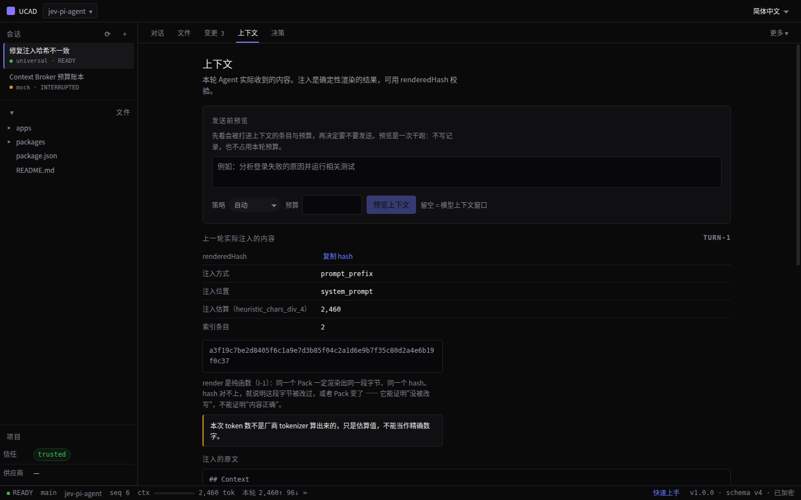
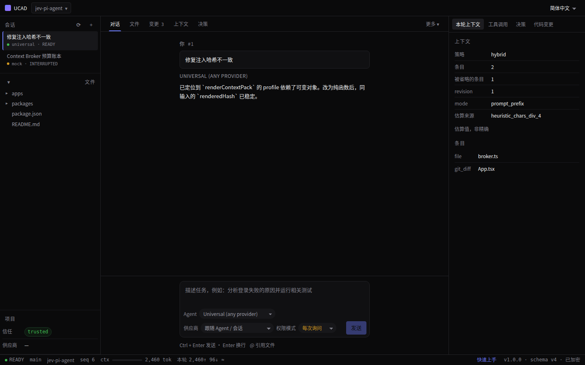
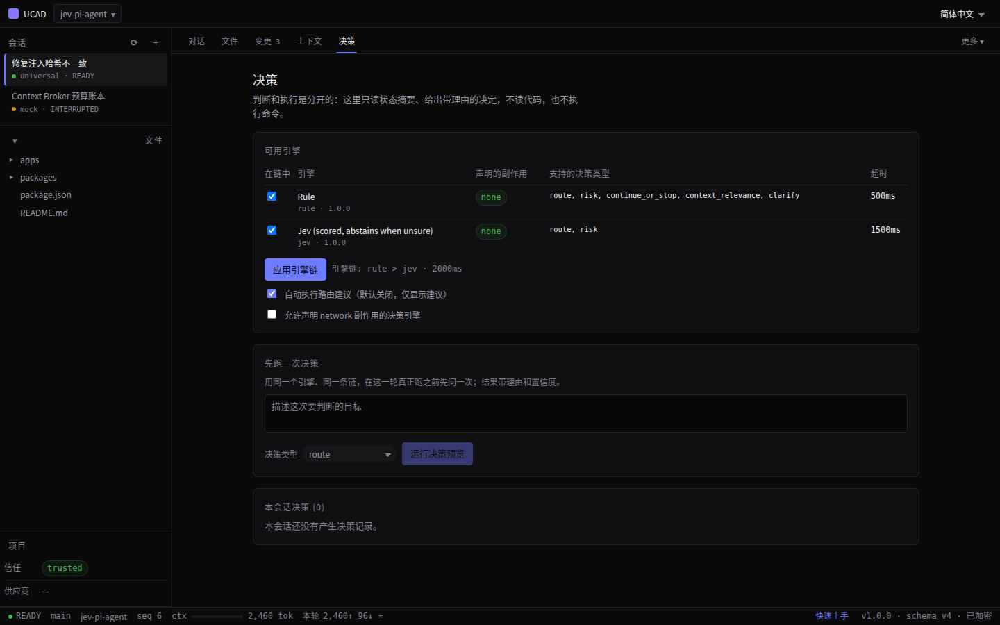
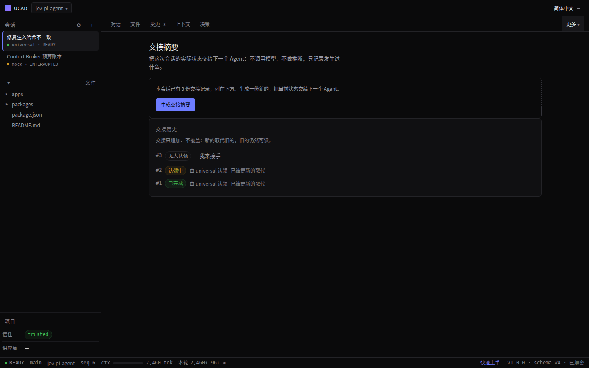
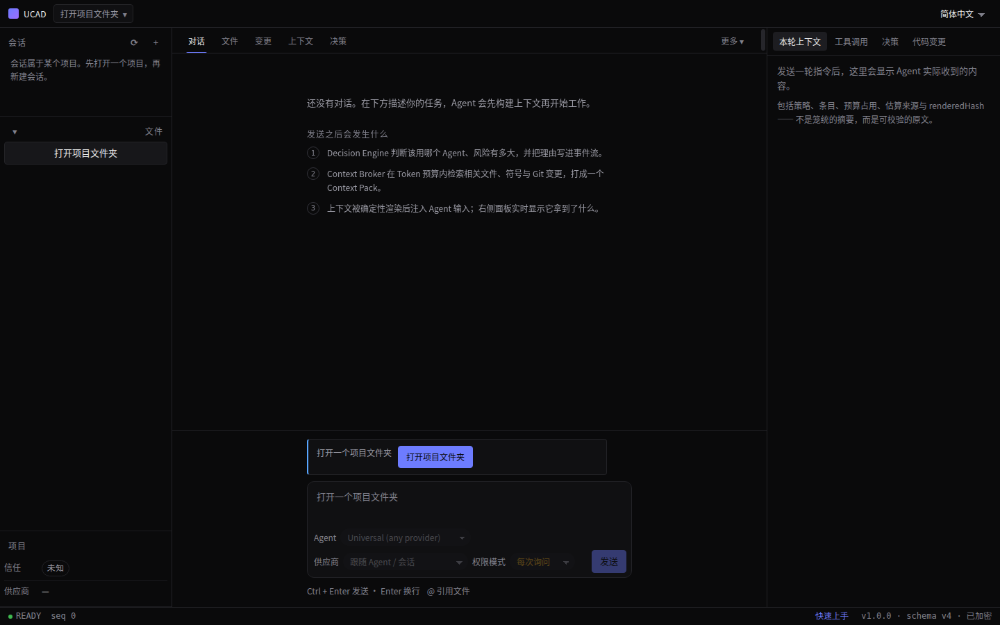
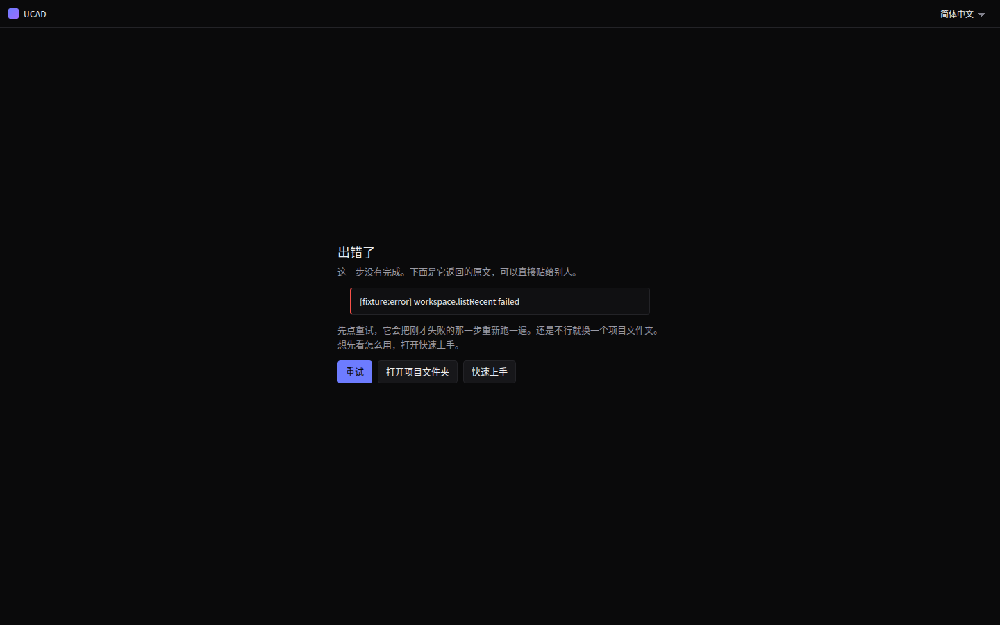
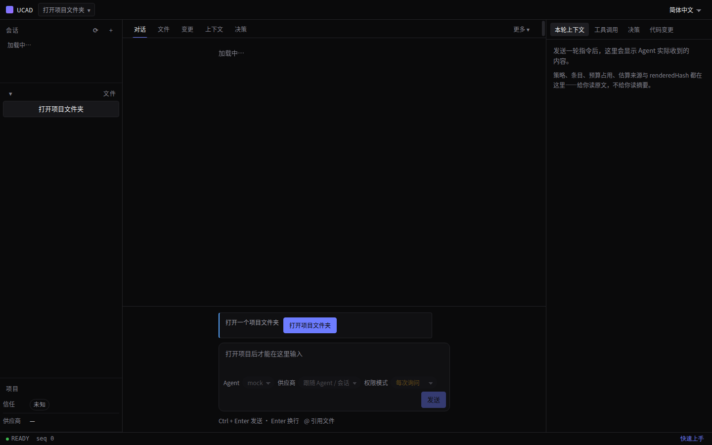
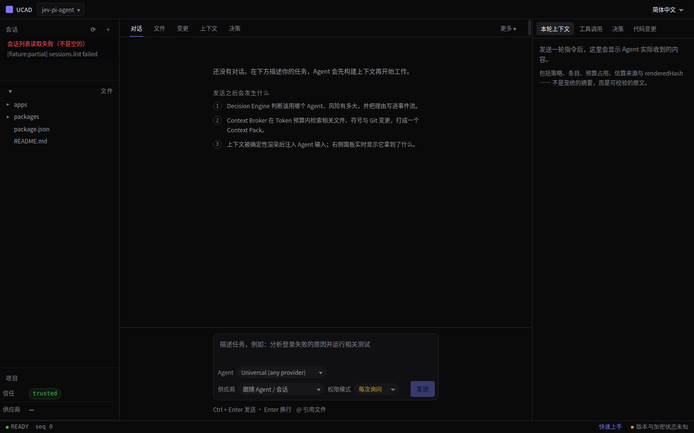
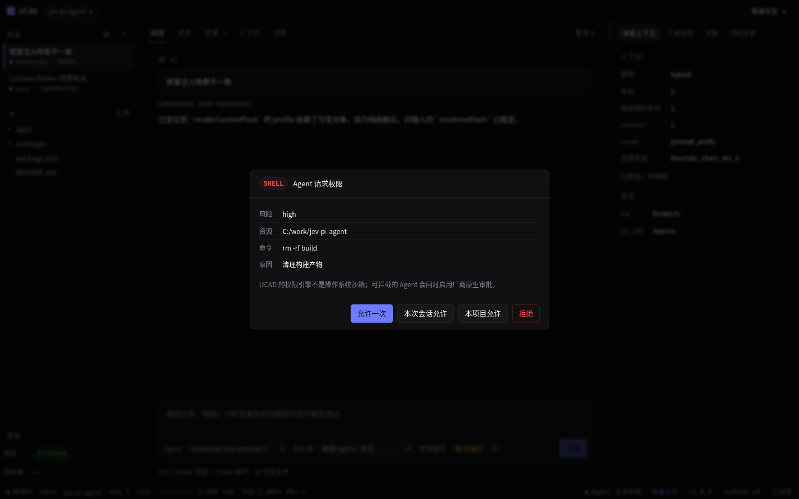

# UCAD

**Three coding agents, one workspace. Open the Context drawer and check the exact bytes the last turn received against their hash.**

[English](#english) · [中文](#中文)



---

## English

Three coding agents are working on one repository. One of them rewrites a file
you did not expect it to touch, and the only explanation on offer is that the
model decided to. The prompt you wrote is not the prompt it saw: a broker
trimmed it, a budget ledger dropped two files, a token estimator guessed at the
rest, and the engine that answered may not be the one you configured. Nothing
on screen can tell you what actually went in, or why it went that way.

UCAD closes that gap and makes both answers checkable: **which bytes did the
agent receive**, and **why did it take that route**. The context pack is a pure
function with a content hash, so you can read the rendered text and compare the
digest. Every decision records its engine, its rationale and its confidence, and
a fallback is recorded as a fallback.

The rest of this page shows how each of those checks works.

### What it does

- **Verifiable injection.** The context pack is produced by a pure function and
  carries a content hash. You can read the rendered text and compare the hash —
  change one byte and it stops matching.
- **Explainable routing.** Every decision records its rationale, its confidence
  and the engine that produced it. A fallback is recorded as a fallback. The
  engine chain is yours to set in Settings — an engine this build does not know
  is ignored, and the chain you see is the chain that runs.
- **Honest estimates.** Token counts say whether they came from the vendor's
  tokenizer or from a heuristic, and say so on screen.
- **A permission gate that cannot be bypassed.** An agent asking to run
  something gets a decision recorded, with the reason, before it happens.
- **Handoffs between agents.** A readable record of what was decided, changed,
  run and left open — the next agent reads it instead of re-asking you.
- **Project rules that follow the project.** A repository's own instructions
  live in `<project>/.ucad/skills/<name>/SKILL.md`. They are injected as
  ordinary context items, so you can read them in the Context Drawer, and they
  change with the project you have open — not with the one you opened first.
- **Any OpenAI-compatible provider.** One protocol, many vendors. Credentials
  are stored one-way in the OS keychain, and the key is handed to the Agent
  Host only when a request needs it — over the local process channel, in
  memory, never through an environment variable or a log line. The vendor you
  pick is the vendor that answers: the base URL, the model and the credential
  all come from that one choice.
- **MCP servers.** Configure a server, see its health honestly, remove it.
- **A tray you can get out of.** Closing the window hides it to the tray — or
  quits the app, if you say so in Settings → When the window is closed. The
  tray menu carries both *Show window* and *Quit*, and an icon that failed to
  decode makes the app quit rather than hide somewhere you cannot see.
- **Bilingual.** The interface is Chinese and English, switchable at runtime.

### Screenshots

| | |
|---|---|
|  |  |
| The conversation surface, with the session list and workspace tree. | The decision plane: engines, what they may decide, and the audit trail. |
|  | |
| The handoff chain: every record with its claim state, newest first — the entry a next agent resumes from. | |

### States

The five states a screen can be in, and what each one tells you:

| | | |
|---|---|---|
|  |  |  |
| First run: it tells you where to start — open a project, pick an agent, send a turn — instead of handing you an empty input box. | A load that failed: what broke, in the words the failure used, and the retry — not a blank panel. | A read still in flight: the screen says it is waiting, so a slow disk never looks like an empty project. |
|  |  | |
| One panel failed: the project name stays on screen, the session list says it could not be read (not that there are no sessions) and why — a local fault, not a whole-page error. | A permission request: the category, risk, resource, command and reason, with all four answers — including 拒绝 — equally findable. | |

The failed-load screen deliberately has no `.rail` and no `.statusbar`: the
workspace never loaded, so drawing an empty one would claim a project that
cannot be opened. The topbar stays, and the four blocks of text are centred in
what is left. That is a decision, not a screen that was never finished — the
reasoning and its cost are in `docs/dod-status.md`, and
`tests/contract/layout.test.ts` asserts both directions.

### Installers

Windows installers are published on the
[Releases page](https://github.com/castorhrio/jev-pi-agent/releases): each
release carries the NSIS setup (`UCAD-Setup-<version>.exe`) plus an
`update-feed.json` the app's update check can read. The installer is unsigned,
so Windows SmartScreen warns on first run.

The app checks for updates on its own — the feed URL ships inside the
installed build. `UCAD_UPDATE_FEED` overrides it for a private or
self-hosted feed. The override must be an `https` URL, the same rule the
packaged configuration is held to: an update that installs itself is code
execution, so a cleartext override is refused and the refusal is logged
rather than silently ignored. A value that is not a URL at all is refused the
same way, with the reason logged.

The feed is generated from the installer, so the digest in it is the digest
of the file that was uploaded:

```bash
node scripts/make-update-feed.mjs --version 1.1.0 \
  --installer release/UCAD-Setup-1.1.0.exe \
  --out release/update-feed.json
```

Upload the result as `update-feed.json` on the release. It must carry a
`sha256`: the app hashes the downloaded installer and refuses to launch one
that does not match. A feed without a hash can announce a version, but
nothing is installed from it — the update button says why.

The same command judges a document before and after it is published:

```bash
node scripts/verify-release-feed.mjs --feed-file release/update-feed.json  # the bytes about to be uploaded
node scripts/verify-release-feed.mjs                                      # the bytes that were published
```

It judges them with the rules the app itself enforces, and it names every
check it did not run — `[skipped]`, with the count in the summary — so a green
run never reads as more than it proved. When the published document is already
wrong, replacing it is two commands: `node scripts/publish-feed.mjs --dry-run`
prints the bytes, the URL and the judgements that decide whether the upload
counted, without fetching or writing anything; `--apply --verify` then does it
and re-judges the published bytes. A host that never answers is reported
as `INCOMPLETE` with a `feed-timeout` finding, not as a broken feed: the run
still exits 1, but the next move is to retry the fetch, not to re-upload a feed
that was fine.

### Quick start

Requires Node.js 22.12 or newer (the Electron 44 packaging toolchain and the
test suite both declare it as their floor).

```bash
git clone https://github.com/castorhrio/jev-pi-agent.git
cd jev-pi-agent
npm install
npm run dev
```

`npm run dev` builds everything and launches the desktop app. No API key is
needed until you actually call a model.

To work on the interface without Electron or credentials:

```bash
npm run dev:web
```

This serves the renderer in a browser against an in-memory fixture.
Append `?scenario=empty`, `?scenario=loading`, `?scenario=error`,
`?scenario=partial` or `?scenario=permission` to see the other states.

### Building an installer

```bash
npm run dist     # Windows NSIS installer
npm run package  # unpacked build, no installer
```

**On Windows the installer step needs symlink privilege.** `electron-builder`
extracts a cache archive that contains symbolic links, so Developer Mode must be
on, or the command must run elevated. The unpacked build is unaffected.

### Current limitations

Stated plainly: a tool that hides its edges is harder to trust than one that does not.

#### Known gaps in this repository

Six gaps sit in this repository. Five close here; the last one cannot, and says why.

- **One provider protocol ships.** The bundled adapter speaks the
  OpenAI-compatible protocol. Native vendor adapters are not implemented. Two
  adapters are registered — `universal` is the one that sends real requests,
  and `mock` is the protocol's executable specification for offline development
  and CI. `mock` calls no vendor, so an answer from it is not a real model's
  answer.
- **The installer is unsigned.** Windows SmartScreen warns on first run. The
  download is still checked: the feed publishes a SHA-256, and the app
  refuses to launch an installer whose digest does not match.
- **Auto-update ships with a feed; the override is `https`-only.** The released
  build carries the release feed, so a normal install has nothing to configure.
  `UCAD_UPDATE_FEED` replaces it for a private or self-hosted feed: set it to
  `https://github.com/castorhrio/jev-pi-agent/releases/latest/download/update-feed.json`
  and the update check (Settings → 检查更新) reads that instead. The override
  must be `https`; a cleartext address and a value that is not a URL are both
  refused with the reason logged, and the app does not fall back to the bundled
  feed. That is separate from having no feed at all: with no feed the app says
  so rather than failing quietly.
- **The interactive terminal needs `node-pty`.** It is an optional dependency;
  without it the terminal panel reports that it is unavailable instead of
  pretending to work. The command channel still runs.
- **Adapter resolution inside a real `.asar` archive is verified by hand, with a
  local packaging run; CI does not cover it.** The contract gate resolves a
  package from an asar-shaped app root — the directory semantics Node applies —
  but reading modules from *inside* the archive needs Electron's patched `fs`,
  and no automated gate does that step. Run `npm run package`, then
  `node scripts/verify-packaged-adapters.mjs`: it launches the built app,
  captures its output, and fails unless the `adapters resolved:` line names
  `universal`. On Windows run that from a terminal: a double-clicked build has
  no console attached, so the line has nowhere to appear. The check has been run
  on Linux x64 (Ubuntu 26.04, unpacked build, 2026-11-02): it passed and left no
  child process behind. The Windows re-run is scheduled with the rest of the
  Windows checklist rather than left as a wish — `docs/blockers.md` §2, owner
  `castorhrio`, by 2026-11-19 — because a Linux pass proves the archive path
  works, not that it works on the platform the installer ships for.

- **The gap between Chinese and Latin exists only on screen.** Where a Han
  character meets a Latin letter or digit, the air between them is drawn by the
  engine (`text-autospace: normal`, `--text-autospace` in `styles.css`), not by
  the text: the dictionary writes a space at every boundary a sentence puts the
  two together, and the engine supplies 1/8 em at the ones it cannot — a path, a
  hash, a count, an engine name interpolated into a sentence at runtime. Copy
  that same sentence into a handoff prompt, an issue, or a plain-text log and
  not a pixel of it survives. This one does not close here: it is a property of
  the engine, and the only fix is to write the space into the string itself,
  which is what the dictionary does for the strings this repository writes.

#### Blocked on something this machine does not have

Three of these need something this machine does not have — a token with write
access, a Windows machine, or a person. `docs/blockers.md` gives each one's
command, its expected output, and the path the result goes back to. What the
product is scored against is `docs/PRODUCT-DOD.md`; a review must load it first,
or it cannot tell a gap from a finished item.

- **The published v1.0.0 feed is missing its `sha256` — a release blocker.**
  The asset on the Releases page was written before the feed check existed: it
  carries a version, notes and a `releases/latest` URL, and no digest and no
  size. The app therefore announces the version and installs nothing from it —
  the safe direction, but a real defect in a shipped release rather than a
  hypothetical one, and the moment 1.1.0 exists it takes the update channel down
  for everyone at once. The corrected document is committed at
  `docs/release/update-feed-v1.0.0.json` and judged clean by
  `scripts/verify-release-feed.mjs`; replacing the asset is one command,
  `node scripts/publish-feed.mjs --apply --verify`, which refuses to run without
  a GitHub token with write access on the repository — this machine has none, so
  the step is blocked here rather than unfinished. Until whoever holds that token
  runs it, 1.1.0 must not ship — and that is enforced, not remembered:
  `npm run dist` runs `node scripts/release-gate.mjs` before `electron-builder`
  and refuses to produce an installer while the published feed is one the app
  will not install from. That refusal can be watched on a machine
  that cannot publish anything: `node scripts/release-gate.mjs --simulate-missing-sha`
  prints the same `REFUSED` lines offline and exits 1. Closing it needs a write
  token on the repository: whoever holds one runs
  `node scripts/publish-feed.mjs --apply --verify`, and this machine has none.
- **The Windows run of the manual checklist has not happened.** Steps 1–5 are
  driven by `node scripts/verify-main-chain.mjs`, and they have run on a Linux
  desktop session; Windows is a different platform (DPAPI, tray, NSIS), so the
  same run still has to happen there before a release can claim it. One run can
  be carried home as a file: add `--report win-report.json`, then anyone can
  judge it with
  `node scripts/verify-main-chain.mjs --judge docs/manual-verification/win-YYYYMMDD.json`.
  Exit code 0 means the report covers steps 1–5, says `"platform": "win32"`,
  matches this repository's version, and gives evidence for every `pass` — five
  `pass` lines with nothing recorded are a claim, not a result.
  `docs/manual-verification.md` has the copyable commands and the table a run
  signs. Closing it needs a Windows machine: one run of the six steps there,
  carried home as a report; this host is not Windows.
- **The five interface states have not been walked through by eye.** They are
  asserted, measured and photographed: `npm run test:e2e` checks what each one
  paints, the layout gate measures all five in a real Chromium at 1440×900 and
  at the tightest window, and the images in `docs/screenshots/` are taken by
  that gate — `node scripts/screenshot-sources.mjs --check` is what says those
  images still match the renderer they were taken from, and it cannot say
  anybody looked at them. What has not happened is a person looking at them
  and saying they read as a first run, a failure, a permission prompt.
  `docs/manual-verification.md` step 6 records this as not done, and it is the
  one thing a screenshot cannot answer for itself. The questions to answer are
  written down in
  `docs/state-walkthrough.md` — yes/no criteria per state (three each, four for the
  failed-load screen), anchored to text that is actually on screen, plus the record
  table a walkthrough signs. Until
  that table carries a dated row, this bullet stays. Closing it needs a person
  to look at the five states and sign; no gate can answer that one.

### Contributing

See [CONTRIBUTING.md](CONTRIBUTING.md) — how to run the gates, what the
repository expects of a change, and how to add a workspace package.

### License

[MIT](LICENSE)

---

## 中文

三个编码 Agent 在同一个仓库上干活。其中一个改了你没料到它会碰的文件，而它能给出的
解释只有「模型自己决定的」。你写的提示词也不是它看到的提示词：broker 裁过、预算账本
丢过两个文件、token 估算器猜过剩下的部分，最后回答的那个引擎可能也不是你配的那个。
屏幕上没有任何东西能告诉你：到底进去了什么，以及为什么走了这条路。

UCAD 补的就是这个缺口，并把两个问题的答案做成**可核对**的：**Agent 到底收到了哪些
字节**，以及**它为什么走了这条路由**。Context Pack 由纯函数产出、自带一个内容哈希，
你可以读渲染后的原文、比对哈希；每次决策都记下引擎、`rationale` 和 `confidence`，
回落就写成回落。

下面逐项说明这两件事在界面上怎么核对。

### 它能做什么

- **注入可验证。** Context Pack 由纯函数产出并带内容哈希，
  你可以读渲染后的原文、比对哈希——改动一个字节就对不上了。
- **决策可解释。** 每次决策都记录 `rationale`、`confidence` 和产出它的引擎；
  回落会**作为回落被记录**。引擎链可在「设置」里调整——本版本不认识的引擎会被忽略，
  你看到的那条链就是真正跑起来的那条。
- **估算说实话。** token 数会标明来自厂商 tokenizer 还是启发式估算，并在界面上写明。
- **绕不过的权限门。** Agent 要执行操作前，先得到一个被记录的决定和它的理由。
- **Agent 之间的交接。** 一份可读的记录：决定了什么、改了什么、跑过什么、还剩什么——
  下一个 Agent 读它，而不是再问你一遍。
- **规则跟着项目走。** 仓库自己的规矩放在 `<project>/.ucad/skills/<name>/SKILL.md`，
  它们作为普通上下文项注入——在上下文面板里可以逐字核对；换个项目打开，规则也跟着换，
  而不是留在第一次打开的那个项目上。
- **任意 OpenAI 兼容厂商。** 一个协议覆盖多家。凭据单向存进系统钥匙串，只有真正
  发请求时才经本机进程通道把它交给 Agent Host——全程只在内存里，不经过环境变量，
  也不进日志。选了哪家，就真是哪家：地址、模型和凭据都出自同一个选择。
- **MCP 服务器。** 添加一个、如实读出它的连接状态、随时移除。
- **藏得进去也唤得回的托盘。** 关窗会藏到托盘——也可以在「设置 → 关闭窗口时」改成直接退出。
  托盘菜单里既有「显示主窗口」也有「退出」；图标没解出来时，应用会退出，
  而不是藏到一个你看不见也点不到的地方。
- **中英双语。** 界面语言在运行中随时切换，不用重启。

### 截图

| | |
|---|---|
|  |  |
| 对话界面，左侧会话列表与工作区文件树。 | 决策平面：可用引擎、各自的决策类型、审计记录。 |
|  | |
| 交接链：每一份记录及其认领状态，最新在前——下一个 Agent 从那一条继续。 | |

### 状态

屏幕可能处在的五种状态，以及每一种在告诉你什么：

| | | |
|---|---|---|
|  |  |  |
| 首次启动：它告诉你从哪开始——打开项目、选智能体、发一轮——而不是丢给你一个空输入框。 | 一次彻底失败的加载：坏在哪、失败原文怎么说的、以及重试——不是一个空白面板，也不是一句「出错了」。 | 读取还没返回：屏幕明说它在等，所以一块慢磁盘不会被看成空项目，也不会被当成没有内容。 |
|  |  | |
| 一块面板读失败：项目名还在屏上，会话列说的是「没读出来（不是没有会话）」并带原因——一次局部故障，不是整页错误。 | 一次权限请求：类别、风险、资源、命令、原因五件都能读，四个回答都在且分得清——包括「拒绝」。 | |

失败那一屏故意没有 `.rail` 与 `.statusbar`：工作区根本没加载成功，画一个空的 rail
等于让屏幕声称自己有一个打不开的项目。topbar 留着，四块字在剩下的空间里居中。
这是判断，不是没做完——理由与代价在 `docs/dod-status.md`，
`tests/contract/layout.test.ts` 两个方向都断言。

### 安装包

Windows 安装包发布在
[Releases 页](https://github.com/castorhrio/jev-pi-agent/releases)：每个 release
带 NSIS 安装包（`UCAD-Setup-<版本>.exe`）与一份 `update-feed.json`，供应用的
更新检查读取。安装包未签名，Windows SmartScreen 首次运行会提示。

应用会自己检查更新——feed 地址随安装包一起发布，不需要用户配置。
`UCAD_UPDATE_FEED` 可以覆盖它，指向私有或自建的 feed。覆盖值必须是 `https`
地址，与随包配置受同一条约束：应用会下载并启动这个地址给出的安装包，等于代码执行，
所以明文 feed 一律被拒，并在日志里写明——不会静默忽略。完全不是 URL 的值
同样会被拒绝，原因也会写进日志。

feed 由安装包生成，里面的摘要就是上传的那个文件的摘要：

```bash
node scripts/make-update-feed.mjs --version 1.1.0 \
  --installer release/UCAD-Setup-1.1.0.exe \
  --out release/update-feed.json
```

把生成的文件作为 `update-feed.json` 上传到该 release。它必须带 `sha256`：
应用会对下载到的安装包做哈希校验，摘要对不上就绝不启动。没有哈希的 feed 仍能
报出新版本，但不会从中安装任何东西——更新按钮会说明原因。

上传前后用的是同一条命令，判的是同一套规则：

```bash
node scripts/verify-release-feed.mjs --feed-file release/update-feed.json  # 即将上传的那份字节
node scripts/verify-release-feed.mjs                                      # 已经发布出去的那份字节
```

它会把自己没跑过的检查逐条标成 `[skipped]`，并在总结行里报数量——所以一次
绿色的运行不会被读成「全部都查过了」。如果发布出去的那份已经坏了，覆盖它是两条命令：
`node scripts/publish-feed.mjs --dry-run` 打印将上传的字节、落点 URL 与判定在哪一步跑，
且不联网、不写文件；`--apply --verify` 再做，并对发布出去的字节重新判一次。主机一直不应答时，总结行写的是
`INCOMPLETE` 并给出 `feed-timeout`，而不是把 feed 判成坏的：退出码仍是 1，
但下一步是重试这次抓取，不是去重传一份本来没问题的 feed。

### 快速开始

需要 Node.js 22.12 或更高版本（Electron 44 打包工具链与测试套件都以它为下限）。

```bash
git clone https://github.com/castorhrio/jev-pi-agent.git
cd jev-pi-agent
npm install
npm run dev
```

`npm run dev` 会构建全部产物并启动桌面应用。**不配任何 API key 也能跑起来**，
直到你真的去调用模型。

只做界面开发、不需要 Electron 和凭据：

```bash
npm run dev:web
```

在浏览器里跑渲染层，数据来自内存 fixture。
追加 `?scenario=empty`、`?scenario=loading`、`?scenario=error`、
`?scenario=partial` 或 `?scenario=permission` 可以看其他状态。

### 构建安装包

```bash
npm run dist     # Windows NSIS 安装包
npm run package  # 免安装目录，不出安装包
```

**Windows 上出安装包需要符号链接权限。** `electron-builder` 要解包一个内含符号链接的
缓存包，因此需要开启开发者模式或以管理员身份运行；免安装目录不受影响。

### 当前局限

直说，因为**藏边界的工具比不藏的更不值得信任**。

#### 本仓已知缺口

六条缺口在本仓库里。五条在这里关掉；最后一条关不掉，它自己说了为什么。

- **只随包发布一种厂商协议。** 内置适配器走 OpenAI 兼容协议，厂商原生适配器未实现。
  随包同时注册 `universal` 与 `mock` 两个适配器：前者是真正发出请求的那一个，后者是
  协议的「可执行说明书」，用于离线开发与 CI——它不调用任何厂商接口，所以选它得到的
  回答不代表真实模型。
- **安装包未签名。** Windows 首次运行会有 SmartScreen 提示。下载本身仍然过校验：
  feed 里带 SHA-256，摘要对不上的安装包不会被启动。
- **自动更新出厂自带 feed，覆盖值只接受 `https`。** 发布版把 release feed 带在身上，
  正常安装不需要配置。要指向私有或自建 feed，把 `UCAD_UPDATE_FEED` 设为
  `https://github.com/castorhrio/jev-pi-agent/releases/latest/download/update-feed.json`，
  更新检查（设置 → 检查更新）即会改读它。覆盖值必须是 `https`：明文地址和根本不是
  URL 的值都会被拒绝，原因写进日志，且不会退回随包 feed。这与「完全没有 feed」是
  两件事：没有配置时应用会直说，而不是静默失败。
- **交互式终端依赖 `node-pty`。** 它是可选依赖；缺失时终端面板会如实说不可用，
  而不是假装能跑。命令通道仍然可用。
- **从真实 `.asar` 归档内解析适配器只能手动验证：本地打一次包，CI 不覆盖这一步。**
  契约门禁会从 asar 形状的应用根目录解析一个包——也就是 Node 采用的目录语义——
  但从归档*内部*读取模块需要 Electron 打过补丁的 `fs`，没有自动门禁做这一步：
  手动跑 `npm run package`，再跑 `node scripts/verify-packaged-adapters.mjs`：
  它会启动产物、抓取输出，`adapters resolved:` 那一行不含 `universal` 就判失败。
  Windows 上请从命令行运行 `UCAD.exe`：双击启动的进程没有控制台，这一行没有地方可打印。
  该脚本已在 Linux x64（Ubuntu 26.04、未打包目录构建、2026-11-02）实测通过：
  退出后无残留子进程；Windows 上仍需从命令行跑一次。Windows 那一次不是一句愿望，
  它和六步清单排在一起：`docs/blockers.md` 第 2 节，责任人 `castorhrio`，截止 2026-11-19——
  Linux 上通过证明的是「归档内解析这条路走得通」，不是「安装包要发的那个平台上走得通」。

- **中英之间的空隙只存在于屏幕上。** 汉字与拉丁字母或数字相接的地方，那点空隙由引擎画出来
  （`styles.css` 的 `--text-autospace`，即 `text-autospace: normal`），不是文字自带的：
  词典在句子把两者放在一起的每一处都写了空格，引擎在它写不到的地方补 1/8 em——路径、hash、
  计数、运行时插进句子的引擎名。把同一句话抄进 handoff 提示词、issue 或纯文本日志，
  那点空隙一个像素都不剩。这一条在本仓库关不掉：它是引擎的性质，唯一的修法是把空格写进
  字符串本身，而词典对「本仓库自己写的句子」正是这么做的。

#### 外部阻塞：这台机器没有的东西

其中有三条需要这台机器没有的东西——一个写权限令牌、一台 Windows 机器、一个人。
`docs/blockers.md` 写着每一条跑什么、应该打印什么、结果贴回哪里。产品按什么标准打分
写在 `docs/PRODUCT-DOD.md`；**审查一轮之前必须先读它**，否则分不清「缺口」和「已完成」。

- **已发布的 v1.0.0 feed 缺 `sha256`——这是发布阻塞项。** Releases 页上那份 asset
  写在 feed 判定存在之前：只有版本、说明和一个 `releases/latest` 地址，没有摘要也没有
  大小。应用因此会报出版本、但不会从中安装任何东西——这个方向是安全的，但它是一个已
  发布版本里的真实缺陷，不是假设；而且 1.1.0 一发出去，它就把所有人的更新通道同时带坏。
  修正版文档已经落在 `docs/release/update-feed-v1.0.0.json`，并经
  `scripts/verify-release-feed.mjs` 判为零 finding；覆盖那份 asset 只需一条命令
  `node scripts/publish-feed.mjs --apply --verify`，它在没有仓库写权限令牌时会直接
  拒绝执行——本机没有这个令牌，所以这一步是**卡住**的，不是没做完的。在拿到令牌的人
  跑完它之前，1.1.0 不许发布——而且这句是**被执行的**，不是靠人记得：
  `npm run dist` 会在 `electron-builder` 之前跑 `node scripts/release-gate.mjs`，
  只要已发布的 feed 仍是应用拒绝安装的那一份，它就不出安装包。这次拒绝在没有发布权限的机器上也能**看见**：
  `node scripts/release-gate.mjs --simulate-missing-sha` 离线打印同一份 `REFUSED` 文案并退出 1。
  关掉它**需要写权限令牌**：持有 `castorhrio/jev-pi-agent` 写权限的人跑
  `node scripts/publish-feed.mjs --apply --verify` 即可，本机没有这个令牌。
- **Windows 上的手工清单还没有真机跑过。** 步骤 1–5 由
  `node scripts/verify-main-chain.mjs` 驱动，目前只在 Linux 桌面会话里跑通过；
  Windows 是另一个平台（DPAPI、托盘、NSIS），发布前仍要在那里跑一次。
  一次跑分可以带回成文件：加上 `--report win-report.json`，任何拿到它的人都能用
  `node scripts/verify-main-chain.mjs --judge docs/manual-verification/win-YYYYMMDD.json`
  判定。退出码 0 意味着报告覆盖步骤 1–5、自报 `"platform": "win32"`、
  版本与本仓库一致，且每一步 `pass` 都带着它自己记的证据行——五行 `pass`
  什么都没有，是「声称」而不是「结果」。可复制的命令与签字的表在
  `docs/manual-verification.md`。关掉它**需要一台 Windows 机器**：在那台机器上跑一次六步、
  把报告带回来，本机不是 Windows。
- **五个界面状态还没有被人眼走查过。** 它们被断言、被测量、被拍照：
  `npm run test:e2e` 检查每一态画了什么，布局门禁在真实 Chromium 里把五态在 1440×900
  与最小窗口各量一次，`docs/screenshots/` 里的图就是那道门禁拍的——
  `node scripts/screenshot-sources.mjs --check` 量的是这些图还对着拍下它们的那一版渲染层，
  它说不了有没有人看过。没发生的是**有人看过它们**
  并说「这看起来像首启 / 像失败 / 像权限请求」。`docs/manual-verification.md` 步骤 6
  记着这件事没做——这是截图自己回答不了的那一问。要回答的问题写在
  `docs/state-walkthrough.md`：每态能用「是 / 否」回答的判据（各三条，失败那一屏四条），
  锚在屏幕上真的会出现的字上，外加一张签了字才算数的记录表。那张表没有带日期的一行之前，
  这一条就留着。
  关掉它**需要一个人**：看过五态并签字，这一问机器答不了。

### 参与贡献

见 [CONTRIBUTING.md](CONTRIBUTING.md) —— 怎么跑门禁、这个仓库对一次改动有什么要求、
以及怎么新增一个 workspace 包。

### 许可

[MIT](LICENSE)

